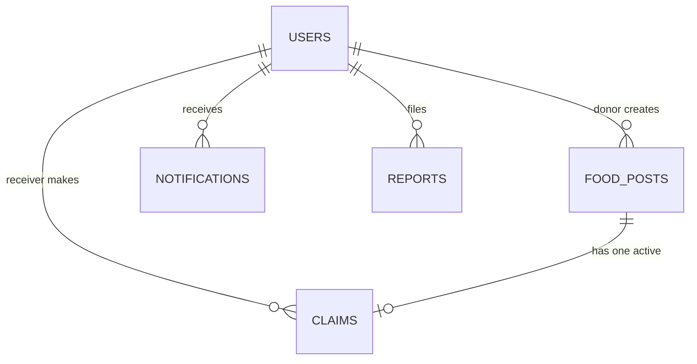
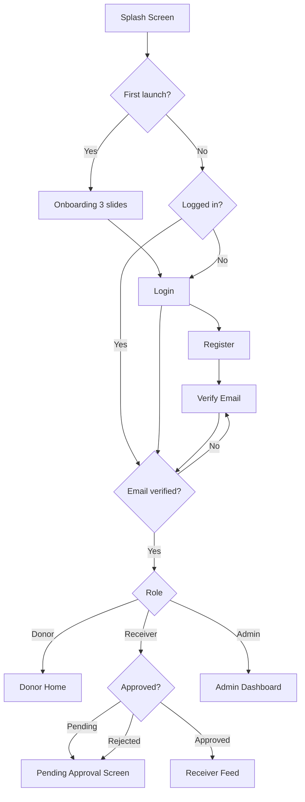
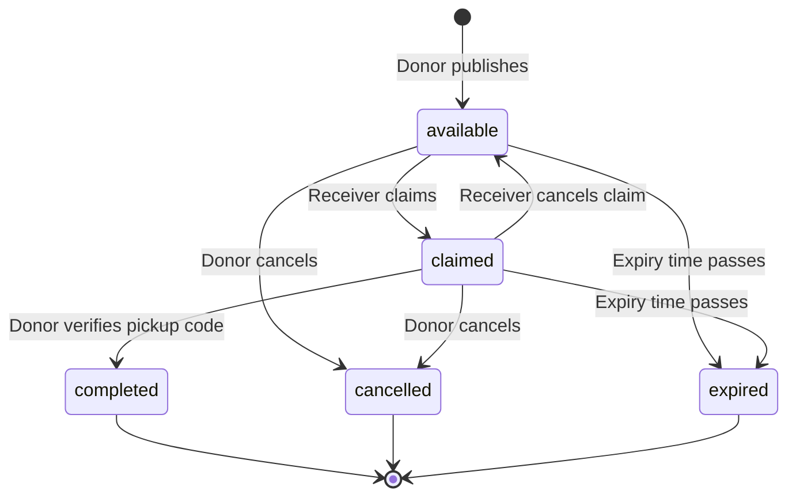

# ResQ Meal — Food Reduction & Redistribution App

> Android app that connects people with surplus food (restaurants, hostel messes, event organizers, individuals) to people who need it (NGOs, shelters, volunteers) before the food goes to waste.

This README is the **single source of truth** for the project. Every UI value, database field, flow and step is defined here. Follow it exactly.

> **Note:** "ResQ Meal" is the working app name. Package name: `com.resqmeal.app`.

---

## Table of Contents

1. [UI/UX Guidelines](#1-uiux-guidelines)
2. [Database Structure](#2-database-structure)
3. [Tech Stack](#3-tech-stack)
4. [App Flow](#4-app-flow)
5. [Features](#5-features)
6. [App Information (Roles, Rules, Working Flows)](#6-app-information)
7. [Implementation Steps](#7-implementation-steps)

---

## 1. UI/UX Guidelines

### 1.1 Design Principles

- Clean, light, friendly, and food-positive (green = fresh, orange = warmth).
- One primary action per screen.
- Every loading state uses a shimmer. Every empty state has an illustration and a message.
- Material Design 3 components with 8dp spacing grid.
- Only a **light theme** is built.

### 1.2 Color Palette

| Name | Hex | Usage |
|---|---|---|
| Primary | `#2E7D32` | Buttons, app bar, active nav item |
| Primary Dark | `#1B5E20` | Status bar, pressed state |
| Primary Light | `#A5D6A7` | Chips background, highlights |
| Accent | `#FB8C00` | FAB, badges, important call-to-action |
| Background | `#F7FAF5` | Screen background |
| Surface | `#FFFFFF` | Cards, dialogs, bottom sheets |
| Text Primary | `#1F2A1F` | Titles and body text |
| Text Secondary | `#5F6B5F` | Subtitles, hints, captions |
| Divider | `#E0E6DD` | Lines and borders |
| Error | `#D32F2F` | Errors and destructive actions |
| Success | `#388E3C` | Success messages |
| Warning | `#F9A825` | Expiring-soon warnings |
| Info | `#1976D2` | Informational elements |
| Shimmer Base | `#E8EEE6` | Shimmer placeholder |
| Shimmer Highlight | `#F7FAF5` | Shimmer sweep |

**Status chip colors**

| Status | Background | Text |
|---|---|---|
| available | `#E8F5E9` | `#2E7D32` |
| claimed | `#E3F2FD` | `#1976D2` |
| completed | `#EEEEEE` | `#424242` |
| expired | `#FFF3E0` | `#E65100` |
| cancelled | `#FFEBEE` | `#D32F2F` |

### 1.3 Typography

Font family: **Poppins** (added in `res/font/`).

| Style | Weight | Size |
|---|---|---|
| Heading 1 | SemiBold | 24sp |
| Heading 2 | SemiBold | 20sp |
| Heading 3 | Medium | 18sp |
| Body | Regular | 14sp |
| Body Bold | Medium | 14sp |
| Caption | Regular | 12sp |
| Button | Medium | 14sp |

### 1.4 Shape, Spacing and Elevation

- Screen padding: 16dp. Spacing scale: 4, 8, 12, 16, 24, 32dp.
- Card: 16dp corner radius, 2dp elevation, white surface.
- Button: 12dp corner radius, 52dp height, full width on forms.
- Input field: Material outlined text field, 12dp corner radius.
- Bottom sheet: 24dp top corners.
- Icons: Material Symbols (Rounded), 24dp.

### 1.5 Animations and Loading States

| Element | Animation | Tool | Duration |
|---|---|---|---|
| Splash logo | Logo scale + fade-in | Lottie | 2000ms |
| Onboarding slides | Lottie illustration per slide, dot indicator slide | Lottie + ViewPager2 | Loop |
| List loading (Feed, My Posts, My Claims, Notifications) | **Shimmer** with 6 placeholder cards | Facebook Shimmer | Until data arrives |
| Profile loading | Shimmer on avatar and text lines | Facebook Shimmer | Until data arrives |
| Button loading | Button text replaced by circular progress, button disabled | Material progress indicator | Until response |
| Full-screen loading (first data fetch, role routing) | Centered circular progress | Material progress indicator | Until response |
| Screen transitions | Shared axis X (forward and back) | Material Motion | 300ms |
| List items entering | Fade + slide up, staggered by 50ms per item | LayoutAnimation | 250ms |
| FAB | Scale in on screen load | ViewPropertyAnimator | 200ms |
| Claim success | Green check animation | Lottie | 1500ms |
| Post published | Confetti-style success animation | Lottie | 1500ms |
| Status chip change | Color crossfade | ValueAnimator | 300ms |
| Pull to refresh | Standard refresh indicator | SwipeRefreshLayout | — |
| Empty state | Lottie illustration + message + action button | Lottie | Loop |
| Bottom navigation | Icon scale on select | Material BottomNavigationView | 150ms |

Interpolator for all custom animations: `FastOutSlowInInterpolator`.

### 1.5.1 Shimmer Rules

- Shimmer placeholder layout must match the real item layout (same card size, image block, two text lines, chip).
- Shimmer starts in `onViewCreated` and stops when the first data (or empty result) arrives.
- Shimmer direction: left to right, duration 1200ms, base `#E8EEE6`, highlight `#F7FAF5`.

### 1.6 Common UI Components (build once, reuse everywhere)

- `PrimaryButton` (with built-in loading state)
- `OutlinedInput` (with error text)
- `FoodCard` (photo, title, quantity, distance, expiry countdown, status chip)
- `StatusChip`
- `EmptyStateView`
- `ShimmerFoodCard`
- `SectionHeader`
- `StatCard` (number + label + icon)
- `ConfirmDialog`
- `PhotoPicker` (camera and gallery)

### 1.7 Screen List

**Common:** Splash, Onboarding, Login, Register, Forgot Password, Email Verification, Profile, Edit Profile, Notifications, Report.

**Donor:** Donor Home, Add Food Post, Post Detail (donor view), My Posts, Verify Pickup Code.

**Receiver:** Receiver Feed, Map View, Food Detail (receiver view), Filter Bottom Sheet, My Claims, Claim Detail (shows pickup code), Pending Approval.

**Admin:** Admin Dashboard, Receiver Approvals, Reports List, Report Detail, Users List.

### 1.8 Bottom Navigation per Role

| Role | Tabs |
|---|---|
| Donor | Home, My Posts, Notifications, Profile (FAB "Add Food" on Home) |
| Receiver | Feed, Map, My Claims, Profile |
| Admin | Dashboard, Approvals, Reports, Profile |

---

## 2. Database Structure

Database: **Cloud Firestore**. All timestamps are Firestore `Timestamp`. All IDs are Firestore auto-generated document IDs, except `users` which uses the Firebase Auth `uid`.

### 2.1 Collections Overview



### 2.2 `users/{uid}`

| Field | Type | Description |
|---|---|---|
| uid | string | Firebase Auth uid |
| name | string | Full name (or organization name) |
| email | string | Login email |
| phone | string | 10-digit mobile number |
| role | string | `donor`, `receiver`, `admin` |
| donorType | string | `restaurant`, `hostel_mess`, `event`, `individual` (donors only) |
| receiverType | string | `ngo`, `shelter`, `volunteer` (receivers only) |
| address | string | Human-readable address |
| lat | number | Latitude |
| lng | number | Longitude |
| geohash | string | Geohash of lat/lng (precision 9) |
| profilePhotoUrl | string | Cloudinary secure URL |
| approvalStatus | string | `approved`, `pending`, `rejected` (donors are `approved` by default; receivers start `pending`) |
| rejectionReason | string | Filled by admin on rejection |
| isActive | boolean | `false` blocks the user from using the app |
| totalPosted | number | Donors: number of posts created |
| totalMealsDonated | number | Donors: sum of `servings` of completed posts |
| totalClaimed | number | Receivers: completed pickups |
| totalMealsReceived | number | Receivers: sum of `servings` of completed pickups |
| createdAt | timestamp | Account creation time |
| updatedAt | timestamp | Last update time |

### 2.3 `food_posts/{postId}`

| Field | Type | Description |
|---|---|---|
| postId | string | Document ID |
| donorId | string | `users` uid of the donor |
| donorName | string | Copied from donor profile |
| donorType | string | Copied from donor profile |
| title | string | Example: "Veg Biryani (cooked)" |
| description | string | Extra details, allergens, packaging |
| foodType | string | `veg`, `non_veg`, `both` |
| category | string | `cooked_meal`, `bakery`, `fruits_veg`, `packaged`, `other` |
| quantity | number | Numeric quantity |
| unit | string | `meals`, `kg`, `packets` |
| servings | number | Approximate number of people it can feed (used for impact stats) |
| photoUrl | string | Cloudinary secure URL |
| photoPublicId | string | Cloudinary public ID |
| pickupAddress | string | Pickup address text |
| lat | number | Pickup latitude |
| lng | number | Pickup longitude |
| geohash | string | Geohash of pickup location (precision 9) |
| pickupInstructions | string | Example: "Ask at the front desk" |
| preparedAt | timestamp | When the food was prepared |
| expiryTime | timestamp | Pickup deadline (best before) |
| status | string | `available`, `claimed`, `completed`, `expired`, `cancelled` |
| claimedBy | string | Receiver uid (empty when available) |
| claimedByName | string | Receiver name (empty when available) |
| claimId | string | Active claim ID (empty when available) |
| createdAt | timestamp | Post creation time |
| updatedAt | timestamp | Last update time |

### 2.4 `claims/{claimId}`

| Field | Type | Description |
|---|---|---|
| claimId | string | Document ID |
| postId | string | Related food post |
| postTitle | string | Copied for quick display |
| donorId | string | Donor uid |
| donorName | string | Donor name |
| receiverId | string | Receiver uid |
| receiverName | string | Receiver name |
| receiverPhone | string | Receiver phone (visible to the donor after claim) |
| pickupCode | string | 4-digit code generated at claim time |
| status | string | `active`, `completed`, `cancelled` |
| cancelReason | string | Filled when cancelled |
| claimedAt | timestamp | Claim time |
| completedAt | timestamp | Pickup confirmation time |
| cancelledAt | timestamp | Cancellation time |

### 2.5 `notifications/{notificationId}`

| Field | Type | Description |
|---|---|---|
| notificationId | string | Document ID |
| toUserId | string | Recipient uid |
| title | string | Notification title |
| body | string | Notification message |
| type | string | `new_post`, `post_claimed`, `claim_cancelled`, `pickup_completed`, `post_expired`, `account_approved`, `account_rejected` |
| refId | string | Related post or claim ID |
| isRead | boolean | Read status |
| createdAt | timestamp | Creation time |

### 2.6 `reports/{reportId}`

| Field | Type | Description |
|---|---|---|
| reportId | string | Document ID |
| reportedBy | string | Reporter uid |
| targetType | string | `post`, `user` |
| targetId | string | Reported post ID or user uid |
| reason | string | `spoiled_food`, `fake_listing`, `no_show`, `abusive_behavior`, `other` |
| description | string | Details written by the reporter |
| status | string | `open`, `resolved`, `dismissed` |
| adminNote | string | Admin's resolution note |
| resolvedBy | string | Admin uid |
| createdAt | timestamp | Creation time |
| resolvedAt | timestamp | Resolution time |

### 2.7 Queries Used by the App

| Purpose | Query |
|---|---|
| Receiver feed (nearby) | `food_posts` where `status == available`, ordered by `geohash`, with geohash range bounds for the selected radius (default 10 km); exact distance and `expiryTime > now` are filtered on the device |
| Donor's posts | `food_posts` where `donorId == uid` ordered by `createdAt` desc |
| Receiver's claims | `claims` where `receiverId == uid` ordered by `claimedAt` desc |
| Unread notifications | `notifications` where `toUserId == uid` and `isRead == false` |
| Pending receivers (admin) | `users` where `role == receiver` and `approvalStatus == pending` |
| Open reports (admin) | `reports` where `status == open` ordered by `createdAt` desc |
| Admin dashboard counts | Firestore `count()` aggregation queries on `users`, `food_posts`, `claims` |

### 2.8 Required Composite Indexes

| Collection | Fields |
|---|---|
| food_posts | `status` ASC, `geohash` ASC |
| food_posts | `donorId` ASC, `createdAt` DESC |
| claims | `receiverId` ASC, `claimedAt` DESC |
| claims | `donorId` ASC, `claimedAt` DESC |
| notifications | `toUserId` ASC, `createdAt` DESC |
| reports | `status` ASC, `createdAt` DESC |

### 2.9 Security Rules (principles to implement in `firestore.rules`)

- Only signed-in users with a verified email can read or write.
- A user can read and edit only their own `users` document. The `role`, `approvalStatus`, `isActive` and stats fields can be changed only by an admin (stats are changed by the app inside transactions).
- Only donors can create `food_posts`, and `donorId` must equal the caller's uid.
- Only the owner donor can edit or cancel their post. The claim transaction is the only way `status`, `claimedBy` and `claimId` change to claimed.
- Only approved receivers can create `claims`.
- A user can read only notifications where `toUserId` equals their uid.
- Only admins can read `reports` of others and update report status.

---

## 3. Tech Stack

| Layer | Technology |
|---|---|
| Platform | Android (minSdk 24) |
| IDE | Android Studio |
| Language | Java 17 |
| UI | XML layouts + ViewBinding + Material Components (Material 3) |
| Architecture | MVVM (Activity/Fragment → ViewModel → Repository → Firebase) |
| Navigation | Android Navigation Component (one nav graph per role) |
| Authentication | Firebase Authentication (email + password, email verification) |
| Database | Cloud Firestore |
| Image storage | Cloudinary (unsigned upload preset) |
| Image loading | Glide |
| Maps | OpenStreetMap through osmdroid |
| Location | Google Play Services FusedLocationProviderClient |
| Geo queries | GeoFire Common (geohash utilities) |
| Notifications | Firestore real-time listeners + Android local notifications (NotificationCompat) |
| Loading effect | Facebook Shimmer |
| Animations | Lottie |
| Version control | Git + GitHub |
| Design | Figma |

### 3.1 Libraries (add latest stable versions in `build.gradle`)

- `firebase-bom`, `firebase-auth`, `firebase-firestore`
- `com.cloudinary:cloudinary-android`
- `com.github.bumptech.glide:glide`
- `org.osmdroid:osmdroid-android`
- `com.google.android.gms:play-services-location`
- `com.firebase:geofire-android-common`
- `com.facebook.shimmer:shimmer`
- `com.airbnb.android:lottie`
- `com.google.android.material:material`
- `androidx.navigation:navigation-fragment` and `navigation-ui`
- `androidx.lifecycle:lifecycle-viewmodel` and `lifecycle-livedata`
- `androidx.swiperefreshlayout:swiperefreshlayout`
- `androidx.viewpager2:viewpager2`

### 3.2 Project Folder Structure

```
com.resqmeal.app
├── ui
│   ├── splash         (SplashActivity)
│   ├── auth           (AuthActivity, LoginFragment, RegisterFragment, ForgotPasswordFragment, VerifyEmailFragment)
│   ├── onboarding     (OnboardingFragment)
│   ├── donor          (DonorActivity, DonorHomeFragment, AddFoodFragment, MyPostsFragment, PostDetailFragment, VerifyPickupFragment)
│   ├── receiver       (ReceiverActivity, FeedFragment, MapFragment, FoodDetailFragment, MyClaimsFragment, ClaimDetailFragment, PendingApprovalFragment)
│   ├── admin          (AdminActivity, DashboardFragment, ApprovalsFragment, ReportsFragment, UsersFragment)
│   └── common         (ProfileFragment, EditProfileFragment, NotificationsFragment, ReportFragment)
├── viewmodel          (AuthViewModel, FoodPostViewModel, ClaimViewModel, NotificationViewModel, AdminViewModel, ProfileViewModel)
├── repository         (AuthRepository, UserRepository, FoodPostRepository, ClaimRepository, NotificationRepository, ReportRepository)
├── model              (User, FoodPost, Claim, AppNotification, Report)
├── adapter            (FoodPostAdapter, ClaimAdapter, NotificationAdapter, ReportAdapter, UserAdapter)
├── utils              (CloudinaryUploader, LocationHelper, GeoUtils, DateUtils, Validators, NotificationHelper, Constants)
└── views              (PrimaryButton, StatusChip, EmptyStateView, ShimmerFoodCard)
```

### 3.3 Cloudinary Configuration

- Create one Cloudinary account and one **unsigned upload preset** named `resqmeal_unsigned`.
- Upload folders: `resqmeal/food_posts`, `resqmeal/profiles`.
- Only the cloud name and the preset name are stored in the app (`Constants.java`). The API secret is never placed in the app.
- Every image is compressed on the device to a maximum width of 1080px and JPEG quality 80 before upload.
- The `secure_url` and `public_id` returned by Cloudinary are saved in Firestore.
- Images are displayed with Glide using the Cloudinary URL transformation `w_600,c_fill,q_auto,f_auto`.

---

## 4. App Flow

### 4.1 Main Flow



### 4.2 Donor Flow

```
Donor Home → Add Food (FAB) → Fill form + photo + location → Publish → Success animation → My Posts
My Posts → Post Detail → (Edit / Cancel / Verify Pickup Code)
Notification "post claimed" → Post Detail → Receiver name + phone → Verify Pickup Code → Completed
```

### 4.3 Receiver Flow

```
Feed (shimmer → list) → Filter → Food Detail → Claim → Success animation → Claim Detail (pickup code)
Map → Marker → Food Detail → Claim
My Claims → Claim Detail → Navigate to pickup → Show code to donor → Completed
```

### 4.4 Admin Flow

```
Dashboard (counts) → Approvals → Approve / Reject receiver
Dashboard → Reports → Report Detail → Resolve / Dismiss / Deactivate user
Dashboard → Users → Search user → Activate / Deactivate
```

### 4.5 Post Status Lifecycle



---

## 5. Features

### 5.1 Common (all roles)

- Email + password registration and login with Firebase Authentication
- Email verification before app access
- Forgot password by email
- Persistent login session
- View and edit profile (name, phone, address, profile photo)
- In-app notification list with unread badge and local notifications
- Report a post or a user
- Logout

### 5.2 Donor Features

- Post surplus food with title, description, food type, category, quantity, unit, servings, photo, pickup location, prepared time and expiry time
- Photo upload through camera or gallery (compressed and uploaded to Cloudinary)
- Pickup location through GPS or by moving a pin on the OpenStreetMap
- See all own posts with status filter (All, Available, Claimed, Completed, Expired, Cancelled)
- Edit a post while it is `available`
- Cancel a post
- See receiver name and phone after the post is claimed
- Verify pickup by entering the receiver's 4-digit code
- Impact stats on Home (total posts, meals donated)

### 5.3 Receiver Features

- Nearby food feed sorted by distance, with shimmer loading
- Filters: distance (2, 5, 10, 25 km), food type, category
- Expiry countdown on every card ("Expires in 1h 20m"), turns orange when under 1 hour
- Map view with markers for all nearby available food
- Food detail with donor info, photo, quantity, pickup address and instructions
- One-tap claim with confirmation
- Claim detail with a 4-digit pickup code and a "Navigate" button that opens the pickup location in the maps app
- Cancel a claim before pickup
- My Claims history
- Impact stats (pickups, meals received)

### 5.4 Admin Features

- Dashboard with counts: total users, donors, receivers, active posts, completed pickups, total meals saved, pending approvals, open reports
- Approve or reject receiver accounts
- View and handle reports (resolve, dismiss)
- Activate or deactivate any user
- Remove any food post

### 5.5 Notification Behavior

Notifications are created as documents in the `notifications` collection and delivered to the target user's device through a Firestore real-time listener, which then shows an Android local notification. They arrive while the app process is alive (foreground or background). Opening the app always loads all unread notifications.

| Event | Sent to |
|---|---|
| New food posted within 10 km of the receiver | Nearby approved receivers |
| Post claimed | Donor |
| Claim cancelled | Donor |
| Pickup completed | Receiver and donor |
| Post expired without pickup | Donor |
| Account approved or rejected | Receiver |

### 5.6 Phase 2 Features (built only after every step in Section 7 is finished)

- Ratings and feedback after pickup
- Hindi and Marathi language support
- Top donors leaderboard
- Dark theme

---

## 6. App Information

### 6.1 Problem and Objective

A large amount of cooked and packaged food is thrown away every day by restaurants, hostel messes, weddings and events, while NGOs, shelters and needy people lack food. **ResQ Meal** reduces food waste by letting donors list surplus food in seconds and letting verified receivers claim and collect it before it expires.

### 6.2 Roles

| Role | Who | How the account is created |
|---|---|---|
| Donor | Restaurant, hostel mess, event organizer, individual | Self registration; approved automatically |
| Receiver | NGO, shelter, volunteer | Self registration; must be approved by Admin before claiming |
| Admin | Project team member | Created manually in Firebase Console (`role = admin` in Firestore) |

### 6.3 Permission Matrix

| Action | Donor | Receiver | Admin |
|---|---|---|---|
| Create food post | ✅ | ❌ | ❌ |
| Edit / cancel own post | ✅ | ❌ | ❌ |
| View available food feed | ❌ | ✅ (approved) | ✅ |
| Claim food | ❌ | ✅ (approved) | ❌ |
| Cancel own claim | ❌ | ✅ | ❌ |
| Verify pickup code | ✅ | ❌ | ❌ |
| Report post or user | ✅ | ✅ | ❌ |
| Approve / reject receivers | ❌ | ❌ | ✅ |
| Handle reports | ❌ | ❌ | ✅ |
| Activate / deactivate users | ❌ | ❌ | ✅ |
| Remove any post | ❌ | ❌ | ✅ |

### 6.4 Business Rules

1. A post must have an expiry time at least 30 minutes after the current time and at most 24 hours after.
2. A post can be claimed by **one receiver only**. The claim is done in a Firestore **transaction** that checks `status == available` and then sets the post to `claimed` and creates the claim.
3. A receiver can hold a maximum of **3 active claims** at the same time.
4. A pickup code is a random 4-digit number generated when the claim is created. Only the receiver and the claim record know it. The donor must type the code to complete the pickup.
5. If the receiver cancels a claim, the post goes back to `available` (if not expired) and the donor is notified.
6. A post past its `expiryTime` is shown as `expired`. The donor's app marks every expired `available` or `claimed` post as `expired` when opened, and every client hides expired posts from the receiver feed.
7. Receivers with `approvalStatus != approved` can see only the Pending Approval screen.
8. Users with `isActive == false` are signed out and see a "Account deactivated" message.
9. Donor phone is shown to the receiver only after the claim. Receiver phone is shown to the donor only after the claim.
10. Impact stats are updated when a pickup is completed: donor `totalPosted` and `totalMealsDonated`, receiver `totalClaimed` and `totalMealsReceived`.

### 6.5 Detailed Working Flows

**A. Registration**
1. User enters name, email, phone, password, selects role (Donor or Receiver), selects donor type or receiver type.
2. App creates the Firebase Auth account and sends the verification email.
3. App creates the `users/{uid}` document (`approvalStatus = approved` for donors, `pending` for receivers).
4. User verifies the email, then logs in and is routed by role.

**B. Donor posts food**
1. Donor taps "Add Food" and fills the form.
2. Donor selects a photo. The app compresses it and uploads it to Cloudinary.
3. Donor sets the pickup location (GPS by default; the pin can be moved on the map).
4. App validates the form, writes `food_posts/{postId}` with `status = available`, and creates notifications for nearby approved receivers.
5. Success animation plays, then My Posts opens.

**C. Receiver claims food**
1. Receiver opens Feed. Shimmer shows while the nearby query runs.
2. Receiver opens a post and taps "Claim".
3. A transaction confirms the post is still available, sets it to `claimed`, creates the claim with a pickup code, and updates the post's `claimedBy` fields.
4. Donor receives a "post claimed" notification.
5. Receiver sees the Claim Detail with the pickup code and a Navigate button.

**D. Pickup completion**
1. Receiver reaches the donor and shows the 4-digit code.
2. Donor opens Verify Pickup on the post and enters the code.
3. If the code matches, a transaction sets the claim to `completed`, the post to `completed`, and updates both users' stats.
4. Both users receive a "pickup completed" notification.

**E. Receiver approval**
1. New receiver sees the Pending Approval screen.
2. Admin opens Approvals and approves or rejects (with a reason).
3. Receiver gets a notification and the app routes to the Feed on the next open or immediately through the live listener.

**F. Reports**
1. User taps "Report" on a post or a user profile, selects a reason, writes details.
2. Admin sees it in Reports, then resolves, dismisses, or deactivates the user.

### 6.6 Validation Rules

| Field | Rule |
|---|---|
| Name | 3 to 50 characters |
| Email | Valid email format |
| Phone | Exactly 10 digits |
| Password | Minimum 8 characters, at least one letter and one number |
| Food title | 3 to 60 characters |
| Description | Maximum 300 characters |
| Quantity | Greater than 0 |
| Servings | Whole number greater than 0 |
| Photo | Required for every food post |
| Expiry | See business rule 1 |
| Pickup location | Required |

### 6.7 Error and Empty States

| Situation | Behavior |
|---|---|
| No internet | Banner "You are offline" and cached Firestore data stays visible |
| Empty feed | Illustration + "No food nearby right now" + "Increase distance" button |
| Empty My Posts | Illustration + "You haven't posted yet" + "Add Food" button |
| Empty My Claims | Illustration + "No claims yet" + "Browse Feed" button |
| Claim failed (already taken) | Dialog "Someone just claimed this food" and the feed refreshes |
| Location permission denied | Screen explaining why location is needed + "Allow" button |
| Image upload failed | Snackbar with "Retry" action |

---

## 7. Implementation Steps

Complete the steps **in order**. Do not start a step until the previous step's "Done when" is true. Commit to Git at the end of every step.

### Step 0 — Setup

- Install Android Studio, create the GitHub repository, add this README to the repo root.
- Create the Android project (Empty Views Activity, Java, minSdk 24, package `com.resqmeal.app`).
- Create the Firebase project, add the Android app, download `google-services.json`, enable Email/Password authentication, create the Firestore database in production mode.
- Create the Cloudinary account and the `resqmeal_unsigned` upload preset.
- Add all libraries from Section 3.1 and enable ViewBinding.
- **Done when:** the app builds and runs on a device with Firebase connected.

### Step 1 — Foundation and Design System

- Create the package structure from Section 3.2.
- Add colors, Poppins font, text styles, shapes and the Material 3 theme from Section 1.
- Build the reusable components from Section 1.6.
- Create the model classes and `Constants.java`.
- **Done when:** a demo screen shows all components with the correct colors and fonts.

### Step 2 — Splash and Onboarding

- Build the Splash screen with the Lottie logo animation and the routing check.
- Build the 3-slide Onboarding (ViewPager2 + Lottie + dots) shown on the first launch only (flag saved in SharedPreferences).
- **Done when:** first launch shows Onboarding and later launches skip it.

### Step 3 — Authentication

- Build Register (with role and type selection), Login, Forgot Password and Verify Email screens with validation from Section 6.6.
- Implement `AuthRepository` and `AuthViewModel`.
- Create the `users/{uid}` document on registration.
- Add button loading states and error messages.
- **Done when:** a new user can register, verify the email, log in, stay logged in after restart, and reset the password.

### Step 4 — Role Routing and Home Shells

- Route after login: Donor → `DonorActivity`, Receiver → `ReceiverActivity` (or Pending Approval), Admin → `AdminActivity`.
- Build each activity with the bottom navigation from Section 1.8 and empty placeholder fragments.
- Block deactivated users.
- **Done when:** each role lands in its own shell with the correct tabs.

### Step 5 — Cloudinary Upload and Profile

- Build `CloudinaryUploader` (compress, upload, return `secure_url` and `public_id`).
- Build `PhotoPicker`.
- Build Profile and Edit Profile (with shimmer loading and profile photo upload) and Logout.
- **Done when:** a profile photo uploads to Cloudinary and appears after restarting the app.

### Step 6 — Location

- Request location permission with the explanation screen.
- Build `LocationHelper` (current location) and `GeoUtils` (geohash, distance, bounding query bounds).
- Build the OpenStreetMap address picker with a movable pin and reverse-geocoded address text.
- Save location and geohash in the profile.
- **Done when:** the picker returns latitude, longitude, geohash and address.

### Step 7 — Donor: Add Food Post

- Build the Add Food form with all fields from Section 2.3 and validation.
- Upload the photo, write the `food_posts` document, show the success animation.
- **Done when:** a published post appears in the Firestore console with a valid Cloudinary photo URL.

### Step 8 — Donor: Home, My Posts and Post Detail

- Build Donor Home (impact stats + recent posts), My Posts (status filter, shimmer, empty state) and Post Detail.
- Implement edit (available posts only), cancel, and automatic expiry marking.
- **Done when:** the donor can view, edit, cancel and see expired posts correctly.

### Step 9 — Receiver: Feed

- Build the Feed with the nearby geohash query, distance calculation, shimmer, expiry countdown, pull to refresh, empty state and the Filter bottom sheet.
- Build Food Detail (receiver view).
- **Done when:** the receiver sees only nearby, unexpired, available posts sorted by distance.

### Step 10 — Receiver: Map View

- Build the map with markers for nearby available posts and a marker tap card that opens Food Detail.
- **Done when:** markers match the Feed results.

### Step 11 — Claim Flow

- Implement the claim transaction, the 3-active-claims limit, pickup code generation and the "already taken" dialog.
- Build Claim Detail (pickup code, Navigate button, cancel claim) and My Claims.
- **Done when:** two receivers claiming the same post at the same time results in exactly one successful claim.

### Step 12 — Pickup Verification and Stats

- Build Verify Pickup (code entry) for the donor.
- Implement the completion transaction and the stats updates from Section 6.4 rule 10.
- Show stats on Donor Home and Receiver Profile.
- **Done when:** a completed pickup updates the post, claim and both users' stats.

### Step 13 — Notifications

- Build `NotificationRepository`, the Firestore listener, `NotificationHelper` (local notifications) and the Notifications screen with unread badge and mark-as-read.
- Create notifications for every event in Section 5.5.
- **Done when:** a claim on one phone produces a notification on the donor's phone.

### Step 14 — Admin Panel

- Build Dashboard (count aggregation cards), Receiver Approvals, Reports list and detail, and Users list with search and activate/deactivate.
- Admin can remove any post.
- **Done when:** the admin can approve a receiver and the receiver's app moves from Pending Approval to the Feed.

### Step 15 — Reporting and Error Handling

- Build the Report screen for posts and users.
- Add every error and empty state from Section 6.7 and offline handling.
- **Done when:** every screen has a loading state, an empty state and an error state.

### Step 16 — Polish

- Add all animations from Section 1.5 and check shimmer layouts match the real layouts.
- Check text sizes, spacing and colors against Section 1.
- Add content descriptions to all icons and images.
- **Done when:** the app looks and feels consistent on at least two different screen sizes.

### Step 17 — Security Rules and Indexes

- Write `firestore.rules` from Section 2.9 and create the indexes from Section 2.8.
- Test each role against the rules.
- **Done when:** a donor cannot claim, a receiver cannot create posts, and a normal user cannot read another user's data.

### Step 18 — Testing and Release

- Test every flow in Section 6.5 on real devices with three accounts (one per role).
- Fix bugs and remove unused code and logs.
- Build the signed release APK.
- Prepare the project report (use case diagram, ER diagram from Section 2, flow diagrams from Section 4) and the live demo script (Donor posts → Receiver claims → Pickup verified → Admin dashboard).
- **Done when:** the full demo runs from start to finish without errors.

---

## Definition of Done (for every step)

- Feature works for the correct role only.
- Loading, empty and error states are implemented.
- Validation rules from Section 6.6 are applied.
- UI matches Section 1.
- Code is committed with a clear message.
